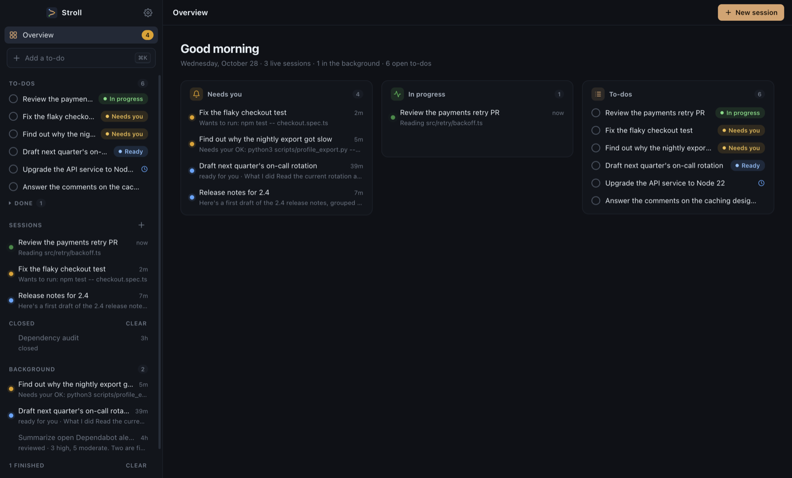
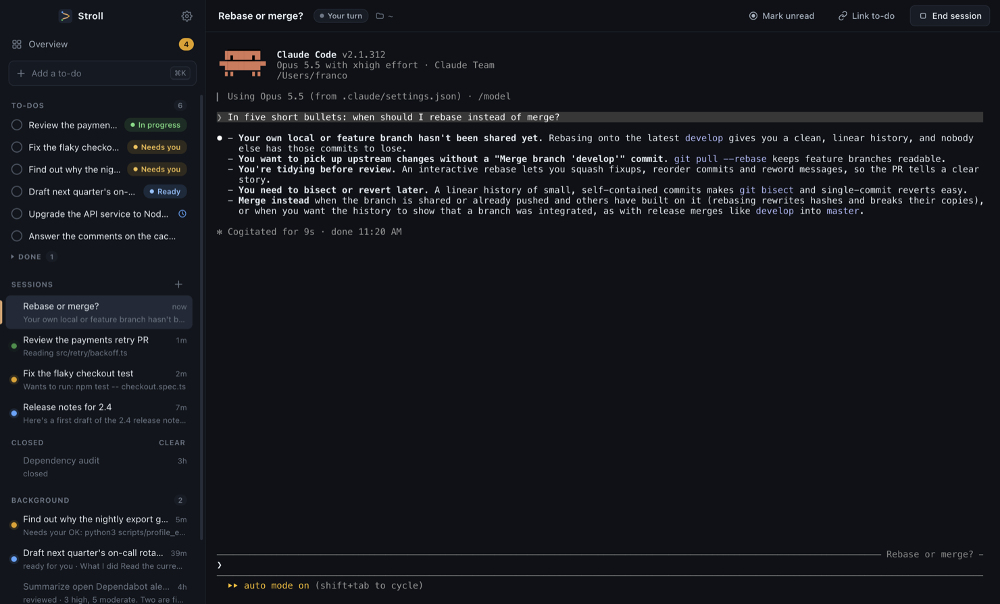
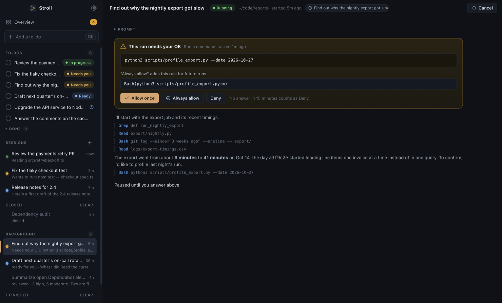
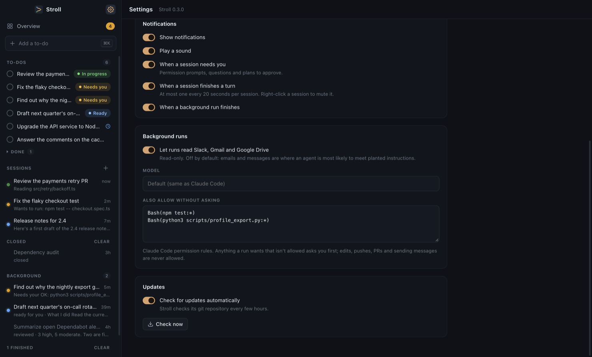
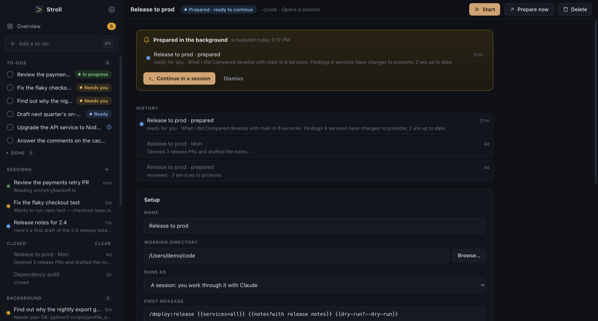
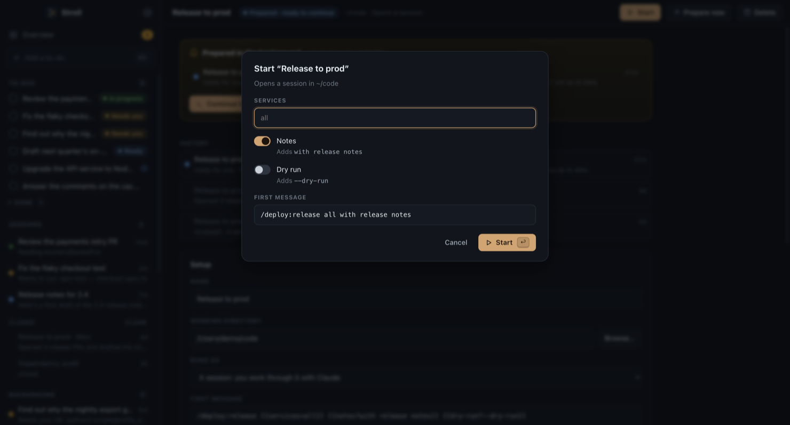

# Stroll

A desktop session manager for [Claude Code](https://claude.com/claude-code). The main pane is the real `claude` terminal UI, exactly as in your terminal, with your settings, skills, hooks and MCP servers. Around it, Stroll adds:

- **Sessions you can see at a glance.** Every session keeps running while you look at another. A dot shows which ones need you: green means working, yellow means it needs you (a permission prompt, a question or a plan to approve), blue means it's your turn and you haven't looked yet. Each row shows a one-line preview.
- **A to-do list you can act on.** Start a session from a to-do (Claude gets it as context), or **hand it off** to a background run. A to-do with a live session shows **In progress**.
- **Workflows for recurring work.** Save a session you run every week (a release, a ticket sync) with the blanks it needs; start it in one click, or schedule it.
- **Background runs.** Hand off research or prep work. A run investigates and drafts, asks you before doing anything outside its read-only list, and pings you when it's ready. You can continue it as a normal session.

macOS only.



## Install

You need:
- macOS
- Node.js 20 or newer (`node -v`)
- Xcode Command Line Tools (`xcode-select --install`)
- Claude Code, installed and logged in once in a terminal (`claude`)

```sh
git clone <this repo> ~/stroll
cd ~/stroll
./install.sh
stroll
```

`install.sh` checks those prerequisites, installs dependencies (it compiles the terminal module for Electron, about a minute) and links `stroll` into `~/.local/bin`.

Stroll runs from this checkout on purpose: an unsigned packaged `.app` would be blocked by macOS Gatekeeper.

## Update

Stroll checks for new versions on its own and shows **Update available**; one click pulls and restarts. From a terminal: `stroll update`.

Restarting ends open sessions. When Stroll comes back, **Resume all** brings them back with their conversations.

## Using it



| | |
| --- | --- |
| ⌘K | Add a to-do |
| ⌘N | New session |
| ⌘J | Jump to the next thing that needs you |
| ⌘0 | Overview |
| ⌘1–9 | Jump to a live session |
| Ctrl+Tab | Next live session (Ctrl+Shift+Tab: previous) |
| ⌘, | Settings |
| Shift+Enter | New line in Claude's prompt |
| Esc | Interrupt Claude (as in the terminal) |

- **To-dos:** **Start** opens a session for the to-do. **Hand off** sends it to a background run. While one is going, **Go to** opens it instead of starting another. ⌘-click several to start or hand off them together. Reminders fire as notifications. Marking a to-do done while it has open sessions asks whether to end them.
- **Inside a session started from Stroll,** Claude can manage your list: "add a to-do to …", "hand this off", "what's on my list?". That's the `stroll` MCP server.
- **Sessions in your home folder** answer Claude Code's "trust this folder" prompt for you. Claude Code never remembers trust for the home folder, so it would ask every time, resumes included. Other folders ask once, as usual.
- **Sidebar sections** collapse when you click their title and move when you drag it. Both are remembered. A collapsed section shows a yellow dot when something inside needs you.
- **Right-click a session** to mark it read or unread, or to mute its notifications.
- **Drag files or screenshots** onto a session to paste their paths, as in iTerm. Claude Code picks up image paths.
- **Elsewhere** lists recent sessions started in other terminals; click one to continue it in Stroll.
- **Closed** sessions and finished runs can be cleared from their lists. Old ones are cleaned up automatically.

## Background runs ask before acting

A background run is a headless `claude -p`. To be safe to leave unattended:

- **It loads none of your Claude Code settings** (`--setting-sources ""`). Neither your personal allow rules nor a repo's "don't ask again" approvals apply.
- **Some tools it uses without asking:** reading files, searching, browsing the web, reading git history and reading GitHub PRs and issues.
- **Anything else asks you first.** Running a script, `git fetch` or an unlisted MCP tool pauses the run. It turns yellow in the sidebar and you get a notification. Open it and choose:
  - **Allow once**: that one call.
  - **Always allow**: also saves an allow rule for future runs. You can edit the rule before saving it.
  - **Allow all for this run**: this call and everything else the run asks for, without asking again. **Ask me again** in the run's header turns it back off.
  - **Deny**: the run skips that step and lists it under "Needs you".

  To skip the questions from the start, turn on **Allow everything it asks for** when you hand off. A hand-off requested from inside a Claude session can't turn it on.

  No answer in 15 minutes counts as Deny. Commands with pipes, loops or variables can only be allowed once.
- **Some things are never allowed,** and it doesn't ask, even with Allow all: editing files, commits, pushes, PRs, deleting, `curl`, and sending Slack messages or emails. A script you let it run is a different matter: it can do anything you can, so only allow all for runs whose inputs you trust.
- **Slack, Gmail and Drive reading** is off by default; turn it on in Settings.
- **It ends with a report:** What I did / Findings / Drafts / Needs you.



The rules you saved with **Always allow** are listed in Settings under **Also allow without asking**, where you can edit or remove them.



Each run uses your Claude plan like any other Claude Code session.

## Workflows

A workflow is a saved session for work you repeat: a folder, a first message (often a skill, such as `/plugin:release`), and the blanks it asks you for each time.



- **Start** opens a short form with the blanks, filled with last time's values, and a preview of the message. Enter opens the session, as if you had typed it.
- **Blanks** in the first message: `{{name}}` is a text field, `{{name=default}}` one with a default, and `{{name?text}}` a switch that adds `text` when it's on.
- **History** lists the sessions and runs it started.
- **Save as workflow:** right-click a session or a background run to turn it into one.
- **Schedule** it for some days at a time. When it's due, Stroll either reminds you, or first runs the **prep message** in the background and tells you when it's ready. The prep message is the read-only half, such as a dry run; you continue it in a session to do the rest.
  - It fires only while Stroll is open. A time missed while Stroll was closed shows up as missed; it doesn't run late.
- **Skills in background runs:** runs load none of your settings, so Stroll turns on just the plugin a `/plugin:skill` message needs, and points a run at a personal skill's `SKILL.md`. A skill that runs shell steps asks you for each one unless the workflow allows everything.
- **Importing:** put a JSON list of workflows in `~/.stroll/workflows-import.json`. Stroll reads it at launch and renames it.



## Data

Everything Stroll keeps is in `~/.stroll`, readable only by you:

| File | What it holds |
| --- | --- |
| `state.json` | To-dos, sessions, runs and workflows |
| `config.json` | Only the settings you changed in Settings |
| `runs/*.jsonl` | The raw output of each background run (deleted with the run) |
| `stroll.log` | The app log |

## Development

```sh
npm start                                        # run from source
STROLL_HOME=/tmp/stroll-test npm start           # separate data folder (runs next to your real Stroll)
node_modules/.bin/electron scripts/render-icon.js   # re-render assets/icon.png from assets/icon.svg
```

Debug variables (with `STROLL_HOME`):

| Variable | Effect |
| --- | --- |
| `STROLL_DEBUG_OPEN=session:<cwd>` | Open that view at start. Also accepts `todo-session:<n>`, `run:<id>` and `todo:<id>` |
| `STROLL_DEBUG_JS=<code>` | Run a snippet in the renderer after load |
| `STROLL_SNAPSHOT=<file.png>` | Save a PNG of the window at start |
| `STROLL_SNAPSHOT_QUIT=1` | Quit after saving the snapshot |

### Layout

| Path | Contents |
| --- | --- |
| `src/main/` | Electron main process: sessions (PTYs), runs and their approvals, the local hook/API server, state, config |
| `src/renderer/` | The UI (vanilla JS and xterm.js) |
| `src/mcp/stroll-mcp.js` | The `stroll` MCP server: to-do tools for sessions, the permission prompt for runs |
| `bin/stroll` | The launcher |
| `docs/screenshots/` | README screenshots (demo data) |
