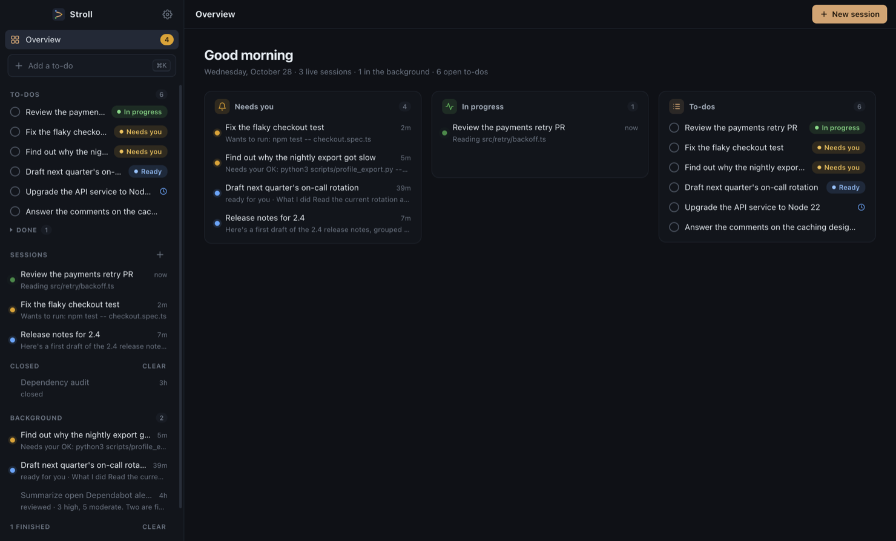
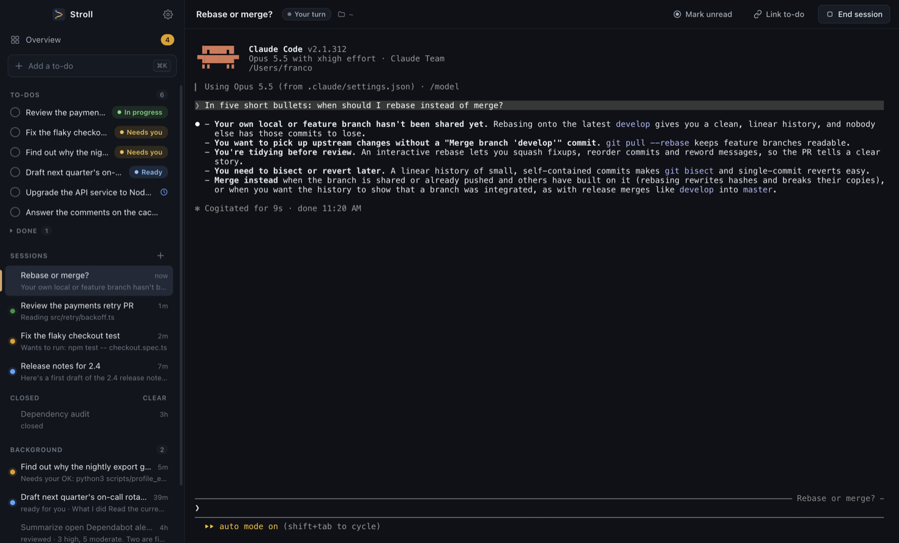
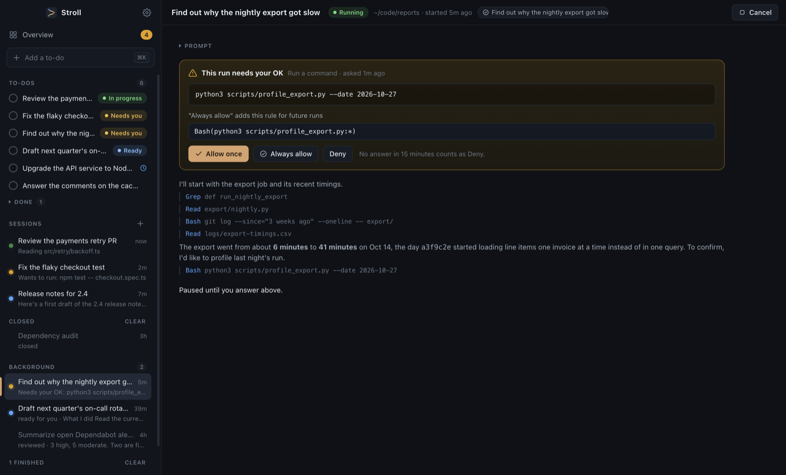
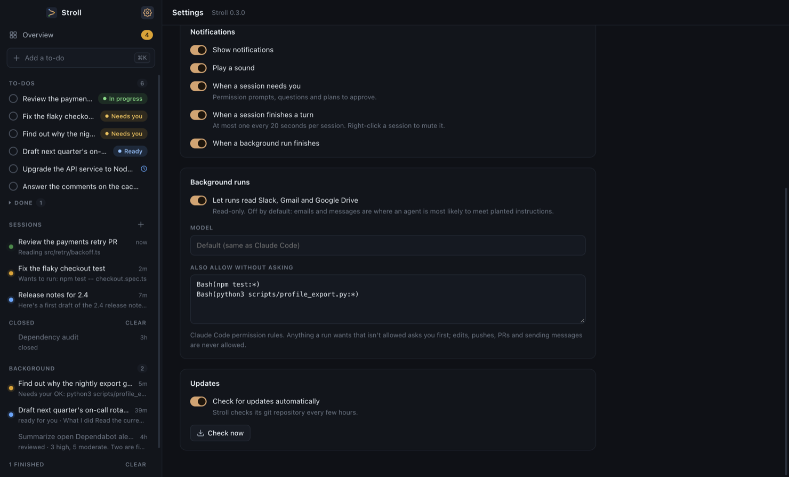
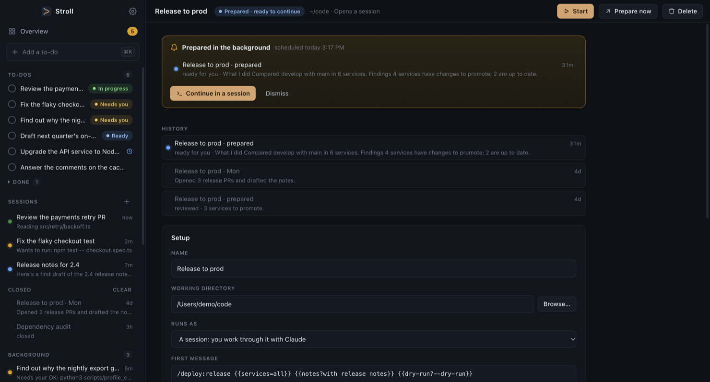
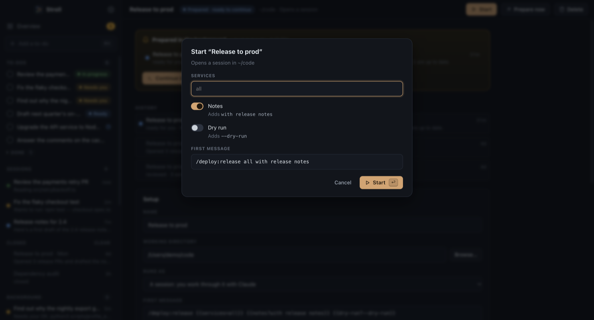

# Stroll

A desktop session manager for [Claude Code](https://claude.com/claude-code). The main pane is the real `claude` terminal UI, exactly as in your terminal, with your settings, skills, hooks and MCP servers. Around it, Stroll adds:

- **Sessions you can see at a glance.** Every session keeps running while you look at another. A dot shows which ones need you: green means working, yellow means it needs you (a permission prompt, a question or a plan to approve), blue means it's your turn and you haven't looked yet, violet means it's your turn but something it started is still running in the background (a shell, an agent, a monitor). A small counter next to the title shows how many background tasks a session has; hover it to see them. Each row shows a one-line preview.
- **A to-do list you can act on.** Start a session from a to-do (Claude gets it as context), or **hand it off** to a background run. A to-do with a live session shows **In progress**.
- **Trails for work that spans many sessions.** A trail keeps shared notes, and every session on it starts with them. Sessions suggest what the next one should know; you accept or dismiss the suggestions.
- **Workflows for recurring work.** Save a session you run every week (a release, a ticket sync) with the blanks it needs; start it in one click, or schedule it.
- **Background runs.** Hand off research or prep work. A run investigates and drafts, asks you before doing anything outside its read-only list, and pings you when it's ready. You can continue it as a normal session.
- **Reach it from your phone.** Pair an Android phone and follow your sessions from anywhere: answer one, read what a run found, approve what it asks for, start a workflow. The phone is told when something needs you. Nothing runs on the phone: your computer has to be on and awake.

macOS and Linux.



## Install

You need:
- macOS or Linux
- Node.js 20 or newer (`node -v`)
- To build the terminal module: on macOS, Xcode Command Line Tools (`xcode-select --install`); on Linux, a C++ compiler, make and Python (Fedora: `sudo dnf install gcc-c++ make python3`, Debian/Ubuntu: `sudo apt install build-essential python3`)
- Claude Code, installed and logged in once in a terminal (`claude`)

```sh
git clone <this repo> ~/stroll
cd ~/stroll
./install.sh
stroll
```

`install.sh` checks those prerequisites, installs dependencies (it compiles the terminal module for Electron, about a minute) and links `stroll` into `~/.local/bin`. On Linux it also adds Stroll to your app menu, with its icon.

Stroll runs from this checkout on purpose: an unsigned packaged `.app` would be blocked by macOS Gatekeeper.

## Update

Stroll checks for new versions on its own and shows **Update available**; one click pulls and restarts. From a terminal: `stroll update`.

Restarting ends open sessions. When Stroll comes back, it reopens them with their conversations, so they're back on the computer and the phone (**Settings › General › Reopen sessions when Stroll starts**). With that off, or for one that can't start, the Overview lists them under **Open when Stroll quit**: resume one, a trail's or all, or dismiss them. The phone has the same list.

After an update, Stroll shows what changed, once. **Settings › Updates › What's new** shows it again; it's [CHANGELOG.md](CHANGELOG.md).

## Using it



| macOS | Linux | |
| --- | --- | --- |
| ⌘K | Ctrl+Shift+K | Add a to-do |
| ⌘N | Ctrl+Shift+N | New session |
| ⌘F | Ctrl+Shift+F | Search everything in the sidebar |
| ⌘J | Ctrl+Shift+J | Jump to the next thing that needs you |
| ⌘0 | Ctrl+Shift+0 | Overview |
| ⌘1–9 | Ctrl+Shift+1–9 | Jump to a live session |
| Ctrl+Tab | Ctrl+Tab | Next live session (Ctrl+Shift+Tab: previous) |
| ⌘, | Ctrl+Shift+, | Settings |
| ⌘\ | Ctrl+Shift+\ | Show or hide the menu |
| ⌘O | Ctrl+Shift+O | Open or narrow the side panel (the journey); with the journey in the middle, show or put away what's open |
| ⌘C / ⌘V | Ctrl+Shift+C / Ctrl+Shift+V | Copy the selection / paste, in a session |
| Shift+Enter | Shift+Enter | New line in Claude's prompt |
| Esc | Esc | Interrupt Claude (as in the terminal) |

On Linux, plain Ctrl keys (Ctrl+K, Ctrl+J, Ctrl+R, Ctrl+V…) go to Claude Code, as in a terminal, so Stroll's own shortcuts add Shift. Elsewhere in this README, read ⌘ as Ctrl on Linux (⌘-click is Ctrl-click). Closing the window quits Stroll there; sessions come back when it starts again.

- **To-dos:** **Start** opens a session for the to-do. **Hand off** sends it to a background run. While one is going, **Go to** opens it instead of starting another. ⌘-click several to start or hand off them together. Reminders fire as notifications. Marking a to-do done while it has open sessions asks whether to end them.
- **A to-do's first message** is what Claude gets when it starts; Start and Hand off fill it in. Give it a time under **Start it automatically** and Stroll starts it then, as a session or a background run. The session opens as if you had pressed Start, with your usual Claude Code permissions and nobody watching it; a background run only reads and drafts. It starts in the to-do's working directory (or its trail's) and nowhere else: without one it can't be scheduled, and if the folder is gone it doesn't start. Starting the to-do yourself first cancels the scheduled start. Like workflows, it fires only while Stroll is open and the computer awake; a missed time, or a start that failed, waits in Needs you with **Start now**. Only Stroll's window on the computer can schedule a start: not the phone, and not the `stroll` MCP tools, which can't move a scheduled to-do to another folder either.
- **Notes, first messages and instructions are markdown editors** (to-dos, trails, Start, Hand off, workflows). The text stays plain markdown, styled as you type (no preview pane): headings, bold, lists, checklists, code. Enter continues a list, Tab indents it, ⌘B/⌘I/⌘E format, and **Structure** inserts an outline for a prompt (task, bug, research, review). Pasting a link over selected text makes it a link.
- **@ references files.** Type `@` for completion over the working directory: names anywhere below it, or a path (`@src/`, `@~/notes/`), with a preview of the file or folder. Dropping files on an editor, or **Browse…**, adds them too. A path with spaces or brackets goes in quotes, `@"docs/my notes.md"`; completion writes them for you. References turn green when they exist and red when they don't. Files that a to-do's or trail's notes, a hand-off's instructions or a workflow's background run reference go to Claude as a list of absolute paths to read. A note's references are looked up in its own working directory (the to-do's, the trail's) first, then in the folder the session starts in, so what the editor shows as found is what Claude gets.
- **Inside a session started from Stroll,** Claude can manage your list: "add a to-do to …", "hand this off", "what's on my list?". That's the `stroll` MCP server.
- **Trails:** **+** in the Trails section starts one; write what every session on it should know in its notes (the goal, the repos, the ticket, decisions, gotchas). **New session** on the trail starts Claude with those notes; a resumed session gets them as they are now. Put an existing session on a trail with **Add to trail** in its header or by right-clicking it, and a to-do with its **Trail** field: sessions and hand-offs started from that to-do get the trail's notes too.
  - **The notes grow as you work.** When Claude learns something the next session would otherwise rediscover, it suggests a line for the notes. Suggestions wait on the trail (a badge in the sidebar counts them): **Add to notes**, edit first, or **Dismiss**. Say "add this to the trail" and Claude writes it right away.
  - **And they stay short.** A suggestion that corrects something in the notes takes that line's place, and the trail shows which line. **Condense** has Claude draft a shorter version of the notes for you to review: edit it, then **Replace notes** or **Dismiss**, and **Undo condense** if you change your mind. Past 800 words Stroll asks for that draft on its own; change the limit or turn it off in **Settings › Trails**.
  - **Workflows can belong to a trail:** connect one under **Workflows** on the trail, or pick the trail in the workflow's Setup. Everything it starts goes on the trail and gets the notes.
  - A trail can **Hand off** a background run, which gets the notes too. **Archive** it when the work is done; archived trails fold under **Archived**.
- **Sessions in your home folder** answer Claude Code's "trust this folder" prompt for you. Claude Code never remembers trust for the home folder, so it would ask every time, resumes included. Other folders ask once, as usual.
- **Three columns:** the menu, what's open, and a side panel. Drag a border to make a column wider or narrower; double-click it to put it back. The middle always keeps about 90 columns for Claude Code (its diffs and tables wrap below that), so in a narrow window the side panel waits as a strip until there's room. ⌘\ hides the menu. Or put the journey in the middle (the map button in the side panel, or **Settings › Layout**): the map takes the window, and a click on someone opens their session beside it, as does anything opened from the menu; put it away (⌘O) to have the whole map again.
- **The journey,** in the side panel: every live session is a walker, and where they stand says what they're doing. In the middle is the hub, where the work happens; close around it, a clearing in the woods for each trail, its camp, there even with nobody out (and the base camp for sessions on no trail). Click a camp's tent to start a new session on that trail. A session's walker comes out of its tent when the session starts or is resumed, and goes back into it when the session ends. Each clearing's path wanders through the woods to the hub in a shape of its own, the same every time, with no bend too sharp; paths cross here and there on the way, and walkers take the shortest way along them. Thinking, they wander the paths; reading or searching, they're at the map board; editing, writing in a notebook on the rock; running commands, at the campfire. A walker at the closed gate with a yellow **!** needs you; one fishing at the pond has something running in the background; one resting on the deck with a tick has finished their turn. Once you've seen it, they stay on the deck a few minutes more with a hot drink, in case you send another message, then walk back to their clearing and doze by the tent. Each subagent, and each agent running in the background, is a pet that follows its walker. Background runs (workflows, hand-offs) are wanderers, hooded and loaded with a pack, a bedroll and a stick: they come out of the woods by their trail's clearing, work at the same stations, wait at the gate when they need your OK, and when they're done they leave a bag in the clearing and go back into the woods. The bag stays until you open the run; click it to open it. Walkers who cross on the way stop to say hello and tell each other, in a few words, what their session is at ("Editing journey.js", "Need your OK for Bash", "Left you a bag"). Those who find themselves at the same spot, round the fire, on the deck or at the board, talk like that now and then too. A breeze comes and goes: gusts cross the woods, leaning the treetops, the grass and the reeds, and now and then carry off a leaf. The light follows your clock: golden in the late afternoon, and at night the campfire, the lanterns and the fireflies glow in the dark. The whole map always fits the panel, however many trails are out. Hover someone for what they're on; click to open their session or run. Narrowed (⌘O), it's a strip of heads with their dots. **Settings › Layout** hides it altogether.
- **The side panel's Trail tab** shows the trail of what's open in the middle: its notes, and what sessions suggest for them, to add or dismiss without leaving the session.
- **Sidebar sections** collapse when you click their title and move when you drag it, and closed sessions fold under their own **Closed** title. All of it is remembered. A collapsed section shows a yellow dot when something inside needs you.
- **Search** (⌘F) filters every sidebar section as you type: to-dos (notes too), trails (notes too), sessions, runs, workflows and Elsewhere. Collapsed sections and the Closed and Archived lists open, limits like "last 8 closed" lift, and a match in hidden text shows as a snippet. ↑↓ and Enter open a match; Esc clears.
- **Right-click a session** to mark it read or unread, or to mute its notifications.
- **Drag files or screenshots** onto a session to paste their paths, as in iTerm. Claude Code picks up image paths.
- **Links Claude prints are clickable.** Web links open in the browser. File links open in Zed at the right line when `zed` is on your PATH. Otherwise macOS opens the file in your text editor, and folders (and anything on Linux) are shown in Finder or the file manager. A file is never run.
- **Elsewhere** lists recent sessions started in other terminals; click one to continue it in Stroll.
- **Closed** sessions and finished runs can be cleared from their lists. Old ones are cleaned up automatically.

## Background runs ask before acting

A background run is a headless `claude -p`. To be safe to leave unattended:

- **It loads none of your Claude Code settings** (`--setting-sources ""`). Neither your personal allow rules nor a repo's "don't ask again" approvals apply.
- **Some tools it uses without asking:** reading files, searching, browsing the web, reading git history and reading GitHub PRs and issues.
- **Anything else asks you first.** Running a script, `git fetch` or an unlisted MCP tool pauses the run. It turns yellow in the sidebar and you get a notification. Open it and choose:
  - **Allow once**: that one call.
  - **Always allow**: also saves an allow rule for future runs. You can edit the rule before saving it.
  - **Allow all for this run**: this call and everything else the run asks for, without asking again. **Ask me again** in the run's header turns it back off.
  - **Deny**: the run skips that step and lists it under "Needs you".

  To skip the questions from the start, turn on **Allow everything it asks for** when you hand off. A hand-off requested from inside a Claude session can't turn it on.

  No answer in 15 minutes counts as Deny. Commands with pipes, loops or variables can only be allowed once.
- **Some things are never allowed,** and it doesn't ask, even with Allow all: editing files, commits, pushes, PRs, deleting, `curl`, and sending Slack messages or emails. A script you let it run is a different matter: it can do anything you can, so only allow all for runs whose inputs you trust.
  - The one exception to editing files: a workflow can name **folders its runs may write in** (see Workflows). Those runs create and edit files there without asking, and nowhere else.
- **Slack, Gmail and Drive reading** is off by default; turn it on in Settings.
- **It ends with a report:** What I did / Findings / Drafts / Needs you.



The rules you saved with **Always allow** are listed in Settings under **Also allow without asking**, where you can edit or remove them.



Each run uses your Claude plan like any other Claude Code session.

## Workflows

A workflow is a saved session for work you repeat: a folder, a first message (often a skill, such as `/plugin:release`), and the blanks it asks you for each time.



- **Start** opens a short form with the blanks, filled with last time's values, and a preview of the message. Enter opens the session, as if you had typed it.
- **Blanks** in the first message: `{{name}}` is a text field, `{{name=default}}` one with a default, and `{{name?text}}` a switch that adds `text` when it's on.
- **History** lists the sessions and runs it started.
- **Trail:** a workflow can belong to a trail. Its sessions, its background runs and its scheduled prep then go on that trail and start with the trail's notes. The start form can pick another trail for one start.
- **Save as workflow:** right-click a session or a background run to turn it into one.
- **Schedule** it for some days at a time. When it's due, Stroll either reminds you, or first runs the **prep message** in the background and tells you when it's ready. The prep message is the read-only half, such as a dry run; you continue it in a session to do the rest.
  - It fires only while Stroll is open. A time missed while Stroll was closed shows up as missed; it doesn't run late.
- **Folders its runs may write in:** for work that keeps its own records, such as a daily digest that saves each report and notes when it last ran. A background run can't edit files, so without this such a run ends with "save and record" left for you, every time. List the folders under Setup (for example `~/.config/tech-digest`) and its runs create and edit files there, and only there, without asking. A link inside a folder that leads out of it doesn't count, and neither does your home folder.
- **Skills in background runs:** runs load none of your settings, so Stroll turns on just the plugin a `/plugin:skill` message needs, and points a run at a personal skill's `SKILL.md`. A skill that runs shell steps asks you for each one unless the workflow allows everything.
- **Importing:** put a JSON list of workflows in `~/.stroll/workflows-import.json`. Stroll reads it at launch and renames it.



## Phone access

Stroll on a phone is a second view of the Stroll running on your computer. Nothing runs on the phone: sessions and runs stay on the computer, which has to be on and awake. It is remote access to that computer, so treat a paired phone like a key to it.

- **Turn it on** in **Settings › Phone access**, press **Pair a phone** and scan the code with the phone's camera. The code works once, for five minutes.
- **The app** is for Android 7 or later, with Chrome. Get it from the page the code opens, or at `/stroll.apk` on the relay's address. The same page works in the phone's browser with nothing installed.
- **What it does:** shows what needs you. Opens a session with its live terminal, a row of keys for prompts (Esc, arrows, Enter) and a message box. Reads a run's report and answers what the run asks for. Adds and ticks to-dos. Starts workflows and new sessions.
- **Trails on the phone:** each trail shows its notes, its to-dos, live sessions, workflows and runs. What sessions suggest for the notes waits there too: touch it up, then **Add to notes** or **Dismiss**. A shorter draft of the notes can be taken or dismissed, and **New session** starts one on the trail, in its folder, with its notes.
- **Notifications:** turn them on in the phone app. **Notify phones** in Settings says when they're sent: only when you're not at Stroll on the computer (the default), always, or never. A kind turned off under Notifications doesn't reach phones either. They go from your computer to the phone through the browser's push service, encrypted so that service can't read them.
- **Dictation:** the microphone by the message box types what you say and keeps listening until you tap it again or send. It hears one language at a time: the phone's own to begin with, and **Change language** above the box adds the others you speak, one tap apart. The speech is recognised by the phone's browser (in Chrome, by Google's speech service), not by Stroll or your computer; only the text is sent, when you press Send.
- **A session's terminal has one size.** Opening it on the phone gives it the phone's size; a click or a key in the computer's window takes it back.
- **Staying awake:** while phone access is on and something is working, Stroll keeps the computer from going to sleep on its own. Closing the lid still stops everything.
- **What a phone can't do:** change settings, set up workflows, edit a trail's notes (the computer's editor knows the files they reference), pair or remove phones, update Stroll, or delete things.
- **Remove a phone** in **Settings › Phone access**. It's disconnected at once and can't come back without pairing again.

### How it stays private

The phone and the computer can't reach each other directly, so they talk through a relay (`relay/`, a Cloudflare Worker). The relay passes messages and can't read or forge them: they're encrypted between the phone and the computer, with keys exchanged when you pair (`src/shared/channel.js`). It stores nothing.

One thing to know: the phone app's code is served from the relay's address. Whoever runs that address decides what code the app runs, so use a relay you trust or run your own. `relay/README.md` says how, and **Settings › Phone access › Relay** points Stroll at it.

## Data

Everything Stroll keeps is in `~/.stroll`, readable only by you:

| File | What it holds |
| --- | --- |
| `state.json` | To-dos, sessions, runs and workflows |
| `config.json` | Only the settings you changed in Settings |
| `remote.json` | Phone access: this computer's keys and its paired phones |
| `runs/*.jsonl` | The raw output of each background run (deleted with the run) |
| `stroll.log` | The app log |

## Development

```sh
npm start                                        # run from source
STROLL_HOME=/tmp/stroll-test npm start           # separate data folder (runs next to your real Stroll)
npm test                                         # tests for transcripts, schedules, What's new and the phone's encrypted channel
node_modules/.bin/electron scripts/render-icon.js   # re-render assets/icon.png from assets/icon.svg
```

Debug variables (with `STROLL_HOME`):

| Variable | Effect |
| --- | --- |
| `STROLL_DEBUG_OPEN=session:<cwd>` | Open that view at start. Also accepts `todo-session:<n>`, `run:<id>` and `todo:<id>` |
| `STROLL_DEBUG_JS=<code>` | Run a snippet in the renderer after load |
| `STROLL_SNAPSHOT=<file.png>` | Save a PNG of the window at start |
| `STROLL_SNAPSHOT_QUIT=1` | Quit after saving the snapshot |

### Layout

| Path | Contents |
| --- | --- |
| `src/main/` | Electron main process: sessions (PTYs), runs and their approvals, the local hook/API server, state, config |
| `src/renderer/` | The UI (vanilla JS and xterm.js) |
| `src/mcp/stroll-mcp.js` | The `stroll` MCP server: to-do tools for sessions, the permission prompt for runs |
| `src/shared/channel.js` | The encrypted channel between the app and a paired phone, the same file on both ends |
| `mobile/` | The phone app (vanilla JS), served by the relay |
| `relay/` | The relay: a Cloudflare Worker that passes messages between a computer and its phones |
| `android/` | Builds the Android app, a shell that opens the phone app |
| `bin/stroll` | The launcher |
| `docs/screenshots/` | README screenshots (demo data) |
